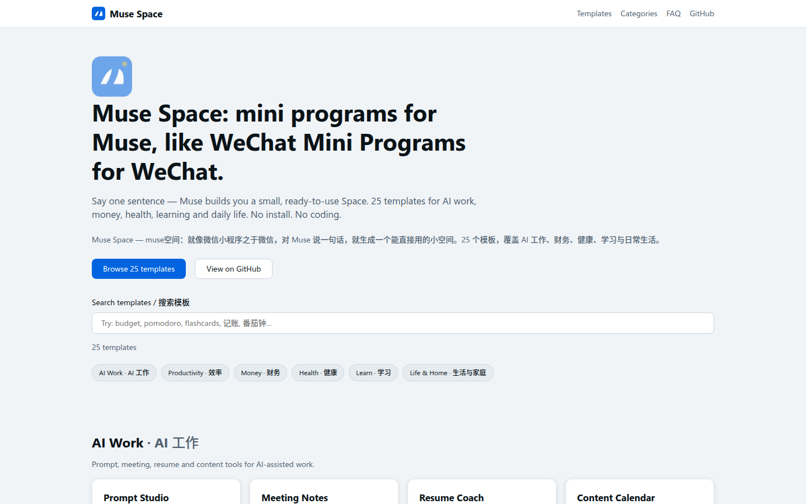
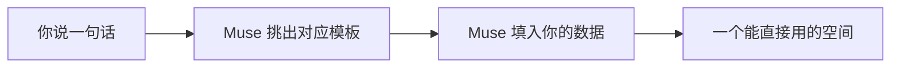
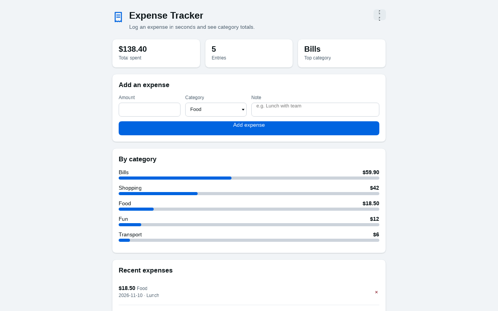
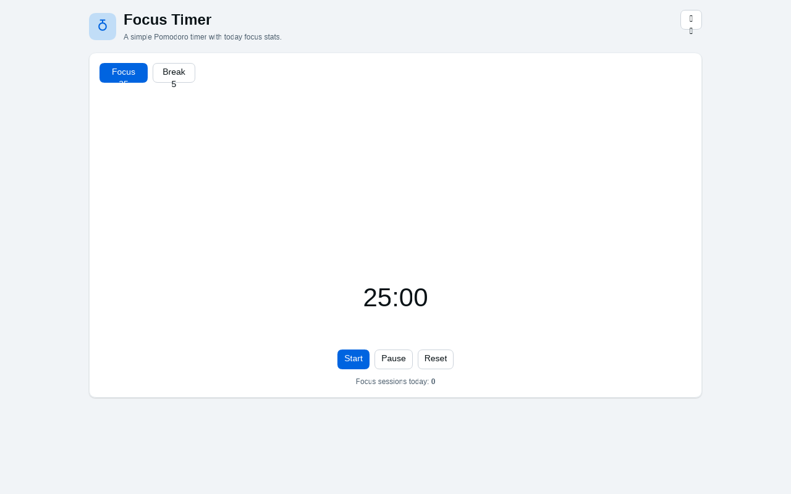
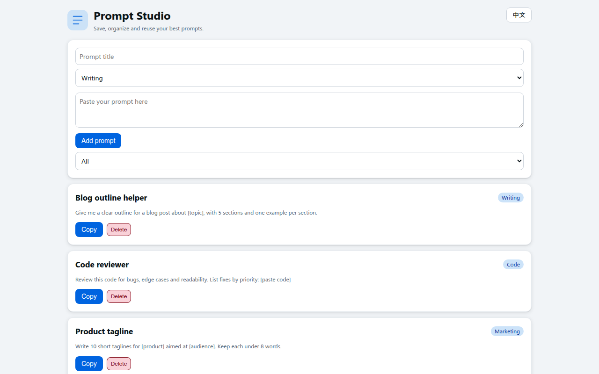
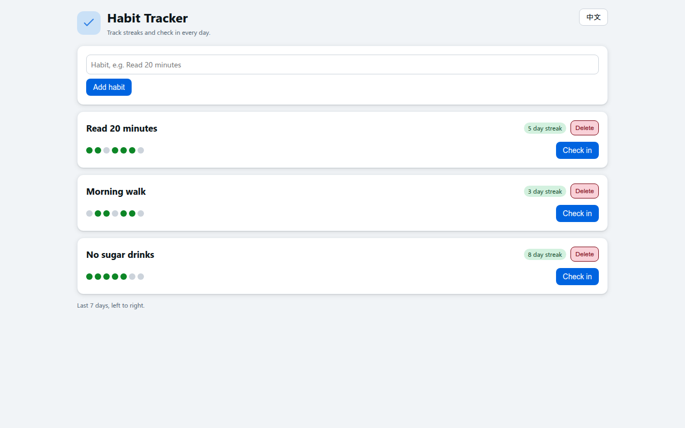
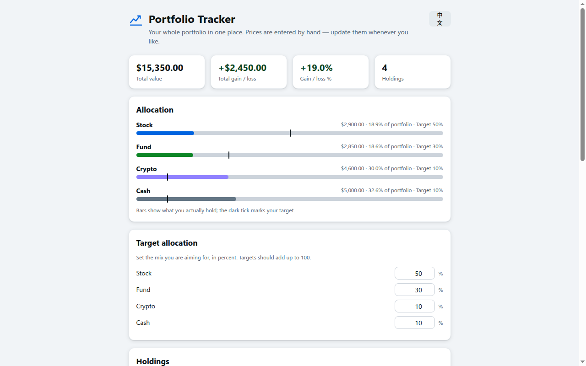
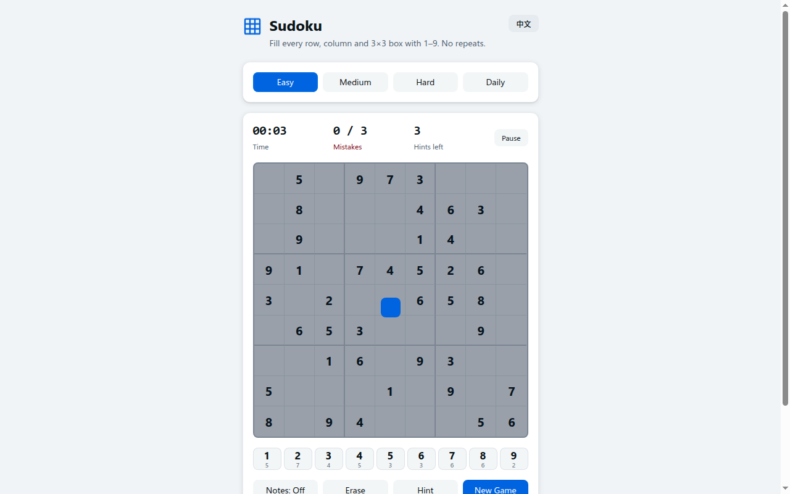
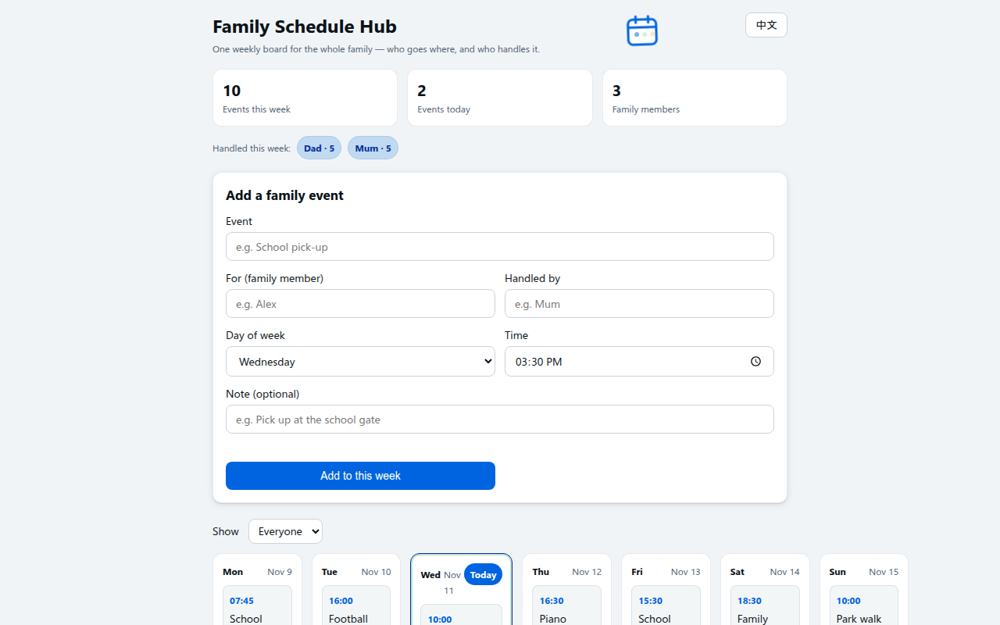
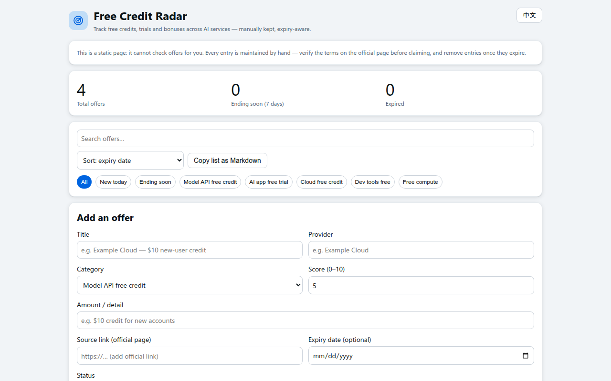

<div align="center">

# Muse Space

**muse空间 · 为 Muse Space 而备的小程序模板库**

48 个开箱即用的模板。对 Muse 说一句话，就生成一个能直接用的空间 — 不用装、不用配置、不用写代码。

[在线预览](https://realfshaw-crypto.github.io/muse-space/) · [模板清单](#模板清单) · [快速开始](#快速开始) · [设计](#设计--astryx) · [常见问题](#常见问题) · [English](README.md)

   



*预览站首页 — 48 个模板全部在内，可按名称与分类搜索。*

</div>

---

## 亮点

| 零配置 | 数据在本地 |
| --- | --- |
| 每个模板就是一个 HTML 文件，复制、打开、就能用，不用构建、不用服务器。 | 数据保存在浏览器本地（localStorage），不上传任何服务器，不离开你的设备。 |

| 一套设计语言 | 双语默认 |
| --- | --- |
| 全部模板共用 Meta Astryx 设计令牌，语义颜色、深浅色自动适配、间距与动效统一。 | 英文为主、中文并行，界面文字简洁，按钮用动词：保存、记一笔、完成。 |

## 它怎么工作

就像微信小程序：单个用途的小应用，不用安装、打开就用。Muse Space 把同样的思路带到 Muse Space，这个仓库就是它背后的模板库。



1. **说一句话。** 用中文或英文说出你需要的工具 — 「打开记账」或 "Open my expense tracker"。
2. **Muse 来挑。** Muse 读取 `templates.json`，从 `templates/<slug>/` 加载对应模板，填入你的数据。
3. **打开就用。** 生成的就是一个成品空间，不用写代码，不用构建。

这个仓库同时是三样东西：一个 **Muse 技能**（`SKILL.md`）、一个 **模板库**（48 个单文件 HTML 模板）、一个 **预览站**（Astro，在 `site/` 目录）。

## 快速开始

1. 把本仓库作为 Muse 技能添加（让 Muse 读取 `SKILL.md`），或直接把仓库链接给 Muse。
2. 用中文或英文说出你的需求：「打开记账」「给我一个番茄钟」「打开习惯打卡」。
3. Muse 读取 `templates.json`，加载对应模板，填入你的数据，生成你的空间。

也可以直接用：浏览器打开 `templates/<slug>/index.html` 即可，不需要服务器。

## 精选模板

| | |
| --- | --- |
|  |  |
| *记账本：记一笔支出，按分类看汇总。* | *专注时钟：25 分钟番茄倒计时与近 7 天专注记录。* |
|  |  |
| *提示词工坊：按分类保存提示词，一键复制。* | *习惯打卡：今日打卡、连续天数、完成率与近 7 天记录。* |
|  |  |
| *投资组合：持仓、总资产、盈亏与目标配置对比。* | *数独：三档难度、每日一题、笔记、提示与最佳成绩。* |
|  |  |
| *家庭日程中心：全家一周日程，谁负责接送一眼看清。* | *免费额度雷达：各家 AI 免费额度与试用，到期倒计时、手动核实。* |

每个模板都有一张这样的截图 — 全部模板可在[预览站](https://realfshaw-crypto.github.io/muse-space/)浏览。

## 模板清单

6 大分类，48 个模板。同一份清单也有机器可读版 [`templates.json`](templates.json)。

### AI 工作
| 模板 | 用途 | 这样说 |
|---|---|---|
| [提示词工坊](templates/ai-prompt-studio/) | 收藏、分类、复用提示词，一键复制 | 打开提示词工坊 |
| [会议纪要](templates/ai-meeting-notes/) | 决议、待办、负责人，结构化呈现 | 记会议纪要 |
| [简历教练](templates/ai-resume-coach/) | 打磨简历要点，核对岗位匹配 | 帮我改简历 |
| [内容日历](templates/ai-content-calendar/) | 选题、排期、发布状态一屏管 | 打开内容日历 |
| [内容生产线](templates/content-pipeline/) | 点子到发布，一条生产线按阶段推进 | 打开内容生产线 |
| [空间提示词生成器](templates/space-prompt-generator/) | 输入赛道，得到一条能直接建 Space 的提示词 | 给咖啡折扣生成一条建空间提示词 |
| [姿势提示词生成器](templates/pose-prompt-generator/) | 点一个姿势，四种格式提示词直接复制 | 打开姿势提示词生成器 |
| [AI 视频工作流](templates/ai-video-workflow/) | 分镜表、各模型提示词与成片任务单 | 帮我排一部 AI 短视频 |
| [免费额度雷达](templates/free-credit-radar/) | 各家 AI 免费额度与试用，到期倒计时、手动核实 | 追踪免费 AI 额度 |

### 效率
| 模板 | 用途 | 这样说 |
|---|---|---|
| [专注时钟](templates/focus-pomodoro/) | 番茄钟、近 7 天专注记录与长休 | 给我一个番茄钟 |
| [习惯打卡](templates/habit-tracker/) | 连续天数、近 7 天打卡与完成率 | 打开习惯打卡 |
| [任务看板](templates/task-kanban/) | 三列看板、优先级 | 打开任务看板 |
| [循环待办](templates/recurring-todos/) | 周期待办，到期提醒，做完自动顺延 | 打开循环待办 |
| [灵感收集箱](templates/idea-capture/) | 灵感随手记，稍后再归类 | 打开灵感收集箱 |
| [复古掌上电脑](templates/retro-organizer/) | 掌上电脑风日程、待办、备忘与通讯录 | 打开复古掌上电脑 |
| [应用中心](templates/app-hub/) | 常用应用与链接收进一个中心 | 打开应用中心 |
| [周时间块](templates/time-block-planner/) | 一周排成时间块，各类时长一目了然 | 打开周时间块 |
| [晨间简报](templates/morning-briefing/) | 日程、要事、邮件分拣与值得看的新闻 | 打开晨间简报 |
| [梯子订阅转换器](templates/proxy-subscription-converter/) | 粘贴梯子订阅，一键转成七种客户端格式 | 转换我的梯子订阅 |

### 财务
| 模板 | 用途 | 这样说 |
|---|---|---|
| [预算管家](templates/budget-planner/) | 月预算与分类上限 | 打开预算管家 |
| [记账本](templates/expense-tracker/) | 几秒记一笔 | 打开记账 |
| [订阅管家](templates/subscription-tracker/) | 续费提醒、年支出与 30 天内续费 | 看看我的订阅 |
| [存钱目标](templates/savings-goals/) | 目标进度与里程碑 | 打开存钱目标 |
| [账单管家](templates/bill-tracker/) | 账单、到期日与刷哪张卡 | 打开账单管家 |
| [投资组合](templates/portfolio-tracker/) | 持仓、总资产、盈亏与目标配置对比 | 打开投资组合 |

### 健康
| 模板 | 用途 | 这样说 |
|---|---|---|
| [健身记录](templates/workout-log/) | 组数、次数、重量、连续打卡与教练提示 | 打开健身记录 |
| [饮食热量](templates/meal-calorie/) | 每餐热量与蛋白质，可改每日目标与最近 7 天记录 | 打开饮食热量 |
| [睡眠心情](templates/sleep-mood-journal/) | 睡眠时长与心情曲线 | 打开睡眠记录 |
| [体重记录](templates/weight-tracker/) | 每天称重、目标体重与趋势线 | 打开体重记录 |

### 学习
| 模板 | 用途 | 这样说 |
|---|---|---|
| [学习计划](templates/study-planner/) | 课表转复习块 | 打开学习计划 |
| [闪卡复习](templates/flashcard-review/) | 间隔重复、掌握度，先练最弱卡片 | 打开闪卡 |
| [阅读追踪](templates/reading-tracker/) | 书单、进度、摘录 | 打开阅读追踪 |
| [趣味问答](templates/trivia-quiz/) | 50 道限时问答、计分连胜、答完复盘 | 打开趣味问答 |

### 生活与家庭
| 模板 | 用途 | 这样说 |
|---|---|---|
| [旅行计划](templates/trip-planner/) | 按天行程、清单、旅行预算 | 打开旅行计划 |
| [买菜食谱](templates/grocery-meal-planner/) | 一周食谱自动带出买菜清单 | 打开买菜清单 |
| [家庭库存](templates/home-inventory/) | 库存、保质期、家务分工 | 打开家庭库存 |
| [礼物清单](templates/gift-tracker/) | 按人记礼物点子、尺码与预算 | 打开礼物清单 |
| [桌游记分](templates/game-score-tracker/) | 每局胜负与对手战绩 | 打开记分板 |
| [宠物日程](templates/pet-day-tracker/) | 遛弯、吃饭、午睡一条时间线 | 打开宠物日程 |
| [餐厅心愿单](templates/restaurant-wishlist/) | 收藏餐厅的价格与评分 | 打开餐厅心愿单 |
| [旅行足迹](templates/travel-memory-map/) | 每次旅行钉上地点与故事 | 打开旅行足迹 |
| [活动倒计时](templates/event-countdown/) | 重要日子还剩几天，一眼看到 | 打开活动倒计时 |
| [食材库存](templates/pantry-tracker/) | 食材库存、数量、保质期提醒与待采购清单 | 打开食材库存 |
| [数独](templates/sudoku-puzzle/) | 能玩的数独，三档难度、每日一题与最佳成绩 | 打开数独 |
| [折扣猎手](templates/deal-hunter/) | 价格关注清单，目标价、下手标记、分类与截止日期 | 打开折扣猎手 |
| [家庭日程中心](templates/family-schedule-hub/) | 全家一周日程，谁负责接送一眼看清 | 打开家庭日程 |
| [比赛记分墙](templates/sports-score-wall/) | 关注的比赛全在一面墙上，附滚动比分条 | 打开比分墙 |
| [节日大餐策划](templates/holiday-feast-planner/) | 宾客与忌口、分菜式菜单、备菜时间线与采购清单 | 帮我策划节日大餐 |

> 48 个模板本体已全部包含，可直接打开使用。

## 设计 — Astryx

全部模板共用一个令牌文件：[`assets/tokens.css`](assets/tokens.css)（Meta Astryx core 默认值，逐字植入）。

- 只用语义令牌，组件只写 `var(--...)`，不写裸 hex 与裸 px。
- 表面层级：body → surface → card → popover。
- 深浅色跟随系统自动切换（`light-dark()`）。
- 动效只用令牌时长：微交互 175ms、进出场 410ms；SVG 动效尊重 `prefers-reduced-motion`。
- 控件高度 28 / 32 / 36px；间距 4px 步进。

## 仓库结构

```text
SKILL.md          Muse 技能定义（触发词与生成规则）
templates.json    全部 48 个模板的机器可读索引
assets/tokens.css Astryx 设计令牌（逐字植入）
templates/        每个模板一个文件夹：index.html + README.md
site/             Astro 5 预览站（GitHub Pages）
llms.txt          纯文本项目简介
```

## 常见问题

**Muse Space 是什么？**
Muse Space 是一个 Muse 技能加一个模板库，包含 48 个开箱即用的 Muse Space 小程序模板。它仿照微信小程序：单个用途的小应用，不用安装、不用写代码，打开就用。

**Muse Space 怎么工作？**
你用中文或英文说一句话，说出你需要的工具。Muse 读取 `templates.json`，从 `templates/<slug>/index.html` 加载对应模板，填入你的数据，生成一个能直接用的空间。

**Muse Space 包含哪些模板？**
共 48 个模板、6 大分类：AI 工作（9 个）、效率（10 个）、财务（6 个）、健康（4 个）、学习（4 个）、生活与家庭（15 个）。每个模板都是一个独立的 HTML 文件，数据保存在浏览器本地（localStorage）。

**Muse Space 免费且开源吗？**
是。本项目以 MIT 许可证发布，可以复制、修改和复用任何模板。

## 许可证

MIT，见 [LICENSE](LICENSE)。© 2026 realfshaw-crypto。
